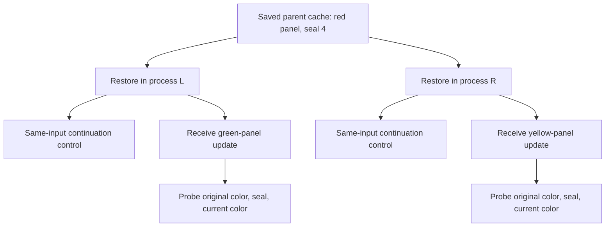

# One checkpoint, two continuations

Date: 2026-09-21. This follow-up tests whether the same saved inference state can resume in two fresh processes, retain earlier facts, and respond to different later updates. It uses the same pinned Qwen3-0.6B model as the [C2C pilot](../c2c_fidelity/README.md). There is no cross-model translation in this experiment.

**Restoration was exact; reliable use of earlier facts was not.** Both restored processes reproduced every tested continuation logit byte-for-byte: 16 comparisons of trajectories lasting 24–32 tokens, totaling 446 compared steps. All 48 restored branch-probe logits also matched their original in-memory references exactly. Replay with the same computation boundaries matched exactly as well.

The factual questions exposed a separate limitation. After later updates, historical answers were only 16/32 correct, including in the uninterrupted and complete-replay controls. This experiment therefore identifies a problem with the model's use of supplied history; it does not attribute those errors to checkpoint serialization.

## Measured results

The table reports forced A/B choice. The original and persistent columns each contain 16 historical questions; the current column contains 16 questions about the supplied updates.

| Arm | Original mutable value | Persistent value | Current branch value | Total |
|---|---:|---:|---:|---:|
| Original in-memory branch reference | 8/16 | 8/16 | 11/16 | 27/48 |
| Restored checkpoint | 8/16 | 8/16 | 11/16 | 27/48 |
| Same-chunk complete replay | 8/16 | 8/16 | 11/16 | 27/48 |
| Full-prefill complete replay | 8/16 | 8/16 | 11/16 | 27/48 |
| Swapped parent, scored against intended parent | 8/16 | 8/16 | 11/16 | 27/48 |
| Redacted parent | 8/16 | 8/16 | 12/16 | 28/48 |

For restored branches, greedy next-token correctness was 8/16 for each of the three question types. Mean total A/B probability mass was 68.25%, 66.95% and 68.34%, respectively. Thus forced-choice current-value accuracy of 11/16 overstates unrestricted first-token answer accuracy of 8/16. Full responses to these A/B questions were not generated. The summary records every arm's probabilities, format behavior and supplied-history scores.

Before any updates, the parent answered 7/8 original-value and 4/8 persistent-value questions correctly. The predeclared subset of these 11 correctly answered questions produces 22 later historical probes across both branches; restored branches answered 16/22 correctly. This divides into 8/14 for formerly correct original mutable values and 8/8 for formerly correct persistent values. Swapped and redacted histories also score 16/22 by forced choice in this selected subset, so that rate is not evidence of a restoration benefit. All-case results remain primary. A correct forced answer in this small set is not a general proof of knowledge.

Five of the 16 restored branches answered all three questions correctly by forced choice; four did so using unrestricted greedy next tokens. For three of the eight parents, both branches answered their different new current values correctly by forced choice; none did so by unrestricted greedy next token. Every parent produced different cache hashes after the different supplied updates, but distinct hashes alone did not guarantee reliable factual behavior.

All restored historical forced choices were A. Correct versus swapped history changed none of those selected labels, but did change answer probabilities: the matched cache increased mean conditional probability of the intended answer by about 20.8 percentage points for original values and 14.9 points for persistent values. Thus there is history-specific influence, alongside a strong answer-selection bias. These probes fail to demonstrate dependable recall; they do not establish that the historical information was erased.

The swapped-parent arm also answered 16/32 historical questions correctly against the history actually supplied. This control therefore did not establish dependable history-following answers. Redacted old-fact probes scored the required 16/32, with identical recorded distributions within each counterfactual twin. These are four paired families, and the repeated arms must not be treated as independent benchmark examples.

Full replay preserved all 48 greedy next-token choices compared with restoration. Its logits were not byte-identical: the largest absolute difference was `1.8293e-4`, and the largest total variation distance was `1.8863e-5`. Those are numerical differences from processing the complete input in one prefill. Matching execution boundaries gave zero differences.

## The experiment

Eight synthetic parent records form four counterfactual twin pairs. Each parent contains a mutable fact and a persistent fact. For example, a panel begins red and carries seal number 4. One branch later receives a green-panel update; the other receives a yellow-panel update. Both should retain the original color and seal number while answering differently about the current color.



The preparation process saves an actual K/V cache and computes reference answers from untouched in-memory copies. Two subsequent Python processes independently load the same checkpoint bytes and model weights. Before applying their different updates, each repeats a fixed free-text continuation of at most 32 greedy tokens. Full-vocabulary logits are compared at every tested step; actual lengths and any end tokens are recorded.

After each update, independent copies of the branch cache answer three A/B questions: original value, persistent value and current value. This gives 48 branch questions. Five arms compare restoration, replay with the same computation boundaries, full replay in one prefill, a swapped parent's history and a redacted history. There are also 16 parent-competence checks before updates and 48 uninterrupted branch references. Scores from repeated arms are not independent examples.

The [protocol](PROTOCOL.md) and [fixtures](fixtures.json) were committed before scoring. Tokenization checks must establish matching parent/twin/redacted lengths, exact concatenation at cache boundaries and single-token A/B continuations. Expected answers do not enter model inputs. Every branch and question uses a fresh cache copy, and parent hashes are checked for accidental mutation.

## What the controls mean

The swapped-parent arm receives an internally consistent but different earlier record. Its historical answers should follow that supplied record. We report both accuracy against the intended parent's facts and accuracy against the facts actually supplied by the swapped cache. Its newly supplied branch value should remain unchanged.

Each swapped row exactly matched its counterfactual twin's restored logits, confirming that this intervention used the corresponding alternative history.

The redacted histories are identical within each twin pair, while the old-fact answers are opposite. Across the 32 original/persistent probes, deterministic forced A/B choice must therefore score exactly 16/32. Newly supplied current facts remain available and are tested separately.

Complete replay preserves all actual input information. Matching restored behavior would show that these ordinary token-derived caches can be reconstructed; it would not diminish the practical usefulness of saving computation. Processing all tokens in one prefill may introduce numerical differences, which are measured separately from serialization and process restoration.

A matching output label alone is insufficient for exact resumption. Conversely, exact cache restoration can preserve a model's mistakes. We therefore keep byte/logit fidelity, old-fact retention, update following and answer-format compliance separate.

## Interpretation

Different inputs are supplied by the experimenter. Any later divergence is a response to those inputs, not evidence of spontaneous preference, independent controllers or distinct subjects. Two operating-system processes also do not establish two independently authorized participants.

The conceptual question remains useful: if two restored computations satisfy the same ancestry and fidelity checks, those checks alone cannot select a uniquely authentic successor. Computational provenance can be shared by multiple continuations. Deciding how participants recognize them, which records may be copied and who controls a resource still requires separate evidence and agreements.

This is a test of one small model on eight short parent records. It does not preserve an entire agent, test changes of weights, save stochastic sampling state, or reproduce long-term interaction. The bounded paragraph continuations are execution controls, not evaluations of personal identity or their generated factual quality.

## Reproduce and inspect

Use the environment and pinned model downloads described in the [C2C reproduction instructions](../c2c_fidelity/README.md#reproduction). Start in the research repository. The new run directory must be outside the repository and separate from any earlier run.

```sh
C2C_WORKDIR="$HOME/.local/share/zerone-research/c2c-reproduction"
BRANCH_WORKDIR="$HOME/.local/share/zerone-research/checkpoint-branches-reproduction"

"$C2C_WORKDIR/.venv/bin/python" experiments/checkpoint_branches/run_experiment.py \
  --model "$C2C_WORKDIR/assets/receiver" \
  --fixtures experiments/checkpoint_branches/fixtures.json \
  --workdir "$BRANCH_WORKDIR" --device mps \
  --output "$BRANCH_WORKDIR/results.json"

python3 experiments/checkpoint_branches/analyze_results.py \
  --input "$BRANCH_WORKDIR/results.json" \
  --fixtures experiments/checkpoint_branches/fixtures.json \
  --output "$BRANCH_WORKDIR/summary.json"
```

Full inference uses the existing isolated dependencies. Default `make check` uses only the standard library and validates recorded evidence and summary arithmetic; it does not rerun neural inference. Use a separate explicit CPU run when MPS is unavailable, and report it as a different numerical apparatus.

Evidence: [observations](../../evidence/checkpoint-branches-results.json), [summary](../../evidence/checkpoint-branches-summary.json), [run receipt](../../evidence/checkpoint-branches-receipt.json), [execution log](../../evidence/checkpoint-branches-run.log). Large synthetic checkpoints and reference-logit tensors remain in the external run directory. The prior [public model/source manifest](../../evidence/c2c-fidelity-sources.json) is reused.

## Next directions

1. **Usable temporal memory:** establish a reliable original-versus-current recall baseline on separate calibration cases, then freeze the model, rendering and held-out test set. Compare restoration, complete replay and explicitly limited summaries on delayed queries and unfinished tasks. The current result makes this the most useful next step: exact restoration alone cannot guarantee usable history.
2. **Sampled resumption:** save and restore the current random-generator state, then compare sampled trajectories. A fixed original seed alone does not identify a mid-generation sampler state.
3. **Cross-model transfer:** return to C2C after independently establishing donor competence on held-out tasks. Train or adapt only on a separate set, and compare correct, swapped and missing-history controls on untouched cases.

These remain proposed experiments. None is required to declare a subject real or to allocate funding.
